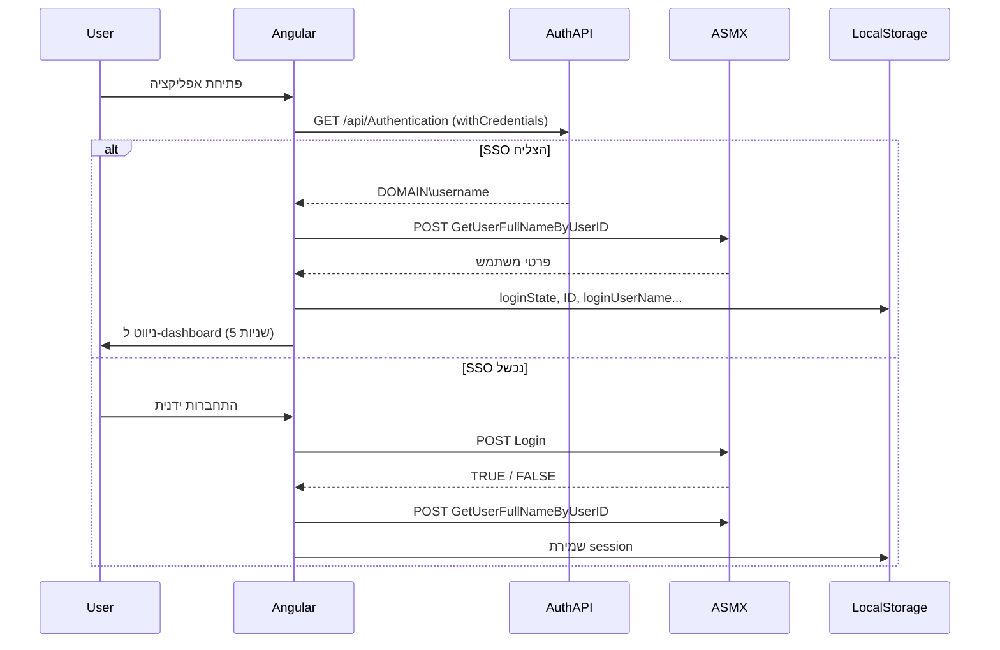
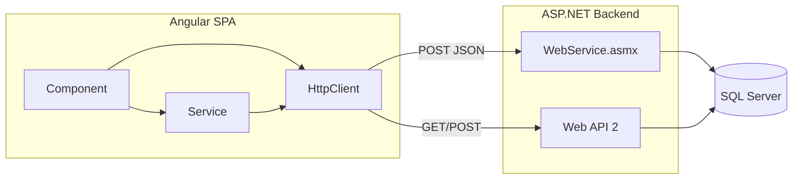

# ארכיטקטורת המערכת

## סקירה כללית

**ONNLINE-APP** הוא אפליקציית SPA (Single Page Application) של Angular שמשמשת כפורטל אינטראנט בית-חולים. הפרויקט מכיל **רק את צד ה-Frontend**; ה-Backend (ASP.NET) והמסד (SQL Server) נמצאים בשרתים חיצוניים ולא ב-repository זה.

| שכבה | טכנולוגיה | מיקום |
|------|-----------|--------|
| Frontend | Angular 9, Angular Material 9 | `src/` |
| API ראשי | ASP.NET WebService.asmx (ScriptService) | `srv-apps-prod:999` (prod) |
| API משני | iPracticom WebService.asmx | `srv-ipracticom:8080` |
| אימות | ASP.NET Web API 2 | `srv-apps-prod:47001/api/` |
| מסד נתונים | SQL Server | שרת חיצוני (לא ב-repo) |
| Hosting | Firebase Hosting (סטטי בלבד) | `firebase.json` → `dist/my-app` |

> **הערה:** ההנחיות לפיתוח מציינות Angular 20 כיעד עתידי. הקוד הנוכחי הוא **Angular 9** עם NgModules (לא Standalone Components).

---

## מבנה אפליקציית Angular

```
src/
├── app/
│   ├── core/              # Routing ראשי, Material module
│   ├── shared/            # קומפוננטות ושירותים משותפים
│   ├── login/             # התחברות (SSO + ידני)
│   ├── dashboard/         # דף בית, קיצורי דרך, AI assistant
│   ├── nps-permissions/   # מודול NPS (lazy-loaded בלבד)
│   ├── hospital-*-dashb/  # דשבורדים בית-חולים
│   ├── [130+ feature folders]
│   └── app.module.ts      # Root module (מונוליתי)
├── environments/          # הגדרות API לפי סביבה
└── assets/
```

### דפוסי ארכיטקטורה

- **NgModule מונוליתי:** רוב הקומפוננטות מוצהרות ב-`app.module.ts` (לא lazy loading).
- **חריג:** `nps-permissions` — מודול lazy-loaded בנתיב `#/nps-permissions`.
- **Hash routing:** `HashLocationStrategy` — כל ה-URLs בפורמט `#/route`.
- **Locale:** עברית (`localeHe`), RTL-friendly Material.
- **HTTP:** `HttpClient` ישירות בקומפוננטות (legacy) או דרך Services (דשבורדים חדשים).

---

## ארכיטקטורת Backend (.NET)

ה-Backend אינו ב-repository. התקשורת מתבצעת כך:

### WebService.asmx (ראשי)

- **פורמט:** ASP.NET AJAX ScriptService
- **URL:** `{environment.url}<MethodName>`
- **בקשה:** `POST` עם JSON body
- **תגובה:** `{ d: <payload> }` — יש לבצע unwrap של `response['d']`

### Web API 2 (אימות + NPS מודרני)

- **URL:** `{environment.AuthUrl}Authentication` (GET, `withCredentials: true`)
- **NPS API מודרני:** `/api/...` על שרת RFC (מתועד ב-`NPS-README.md`)
- Angular קורא ל-NPS דרך WebMethods `Nps*` ב-ASMX שמאצילים לאותה לוגיקה

### iPracticom

- **URL:** `{environment.urlipracticom}<MethodName>`
- משמש לשמירות ספציפיות (commercial support, CPR email, roles, scanners)

---

## SQL Server

- אין קבצי SQL ב-repository.
- סכימת NPS: `NPS` + `dbo.EP_*` (ראה `database.md`).
- Connection string: `NpsConnection` ב-`Web.config` של שרת RFC.
- לוגיקת SQL מוטמעת ב-`RFC/App_Code/Nurses/NursesPermissions.cs`.

---

## זרימת אימות (Authentication)



### Session Storage (localStorage)

| מפתח | תיאור |
|------|--------|
| `loginState` | `"true"` לאחר התחברות |
| `loginUserName` | שם משתמש AD |
| `ID` | EmployeeID (משמש גם ל-NPS `npsUserId`) |
| `Depart` | תיאור מחלקה |
| `FirstName`, `LastName` | שם |
| `FunctionDescription` | תפקיד |
| `LastRout` | נתיב אחרון (לוג ניווט) |

### הגנת נתיבים

- **אין Guard גלובלי** — `AppComponent` מסתיר header/footer כשלא מחוברים.
- **הרשאות לפי route:** `MenuPerm` → `GetPermLinkForUser`.
- **NPS בלבד:** `NpsConfigurationAccessGuard` → `NpsGetAccessContext`.

### Interceptor

`LogAllRequestsInterceptor` — רושם ניווט ב-`LinksLog`. **לא** מצרף tokens או headers אימות.

---

## זרימת נתונים: UI → API → Database



1. קומפוננטה/שירות שולח `POST` ל-`environment.url + MethodName`.
2. ASMX מריץ לוגיקה ב-C# ושולף/שומר ב-SQL Server.
3. תגובה חוזרת כ-`{ d: ... }`.
4. Angular מבצע unwrap ומציג ב-UI (charts, tables, forms).

---

## שירותים חיצוניים

| שירות | שימוש | מיקום בקוד |
|-------|--------|------------|
| AWS Claude | עוזר AI בדשבורד | `AskAIRequestData`, `GetAWSClaudeConfiguration` |
| Google Generative AI | `@google/generative-ai` ב-package.json | שימוש מוגבל |
| WhatsApp | התראות | `SendNotificationToWhatsApp` |
| SMS | שליחת הודעות | `SendSMSOnLine`, `SendSMSOnLineAdmin` |
| Firebase | **Hosting בלבד** — אין Firestore/Auth בקוד | `firebase.json` |
| Google Maps | `@agm/core` | מפות |
| Web Speech API | זיהוי קול | `voice-recognition.service.ts` |

---

## אחריות תיקיות עיקריות

| תיקייה | אחריות |
|--------|--------|
| `src/app/core/` | Routing ראשי, Material imports |
| `src/app/shared/` | GoogleChart, chart utils, date/number utils |
| `src/app/login/` | התחברות SSO וידנית |
| `src/app/dashboard/` | Hub מרכזי, shortcuts, folders, AI |
| `src/app/nps-permissions/` | מערכת הרשאות אחיות (NPS) |
| `src/app/hospital-*-dashb/` | דשבורדים אנליטיים בית-חולים |
| `src/app/form-dashboard/` | טפסים קליניים (CPR, tumor board וכו') |
| `src/app/surgeries-dashborad-n*/` | אנליטיקת ניתוחים |
| `src/environments/` | הגדרות API לפי סביבה |

---

## עדכון אחרון

נוצר: 2026-07-05 — על בסיס ניתוח `cursor/work-branch-114e`.
