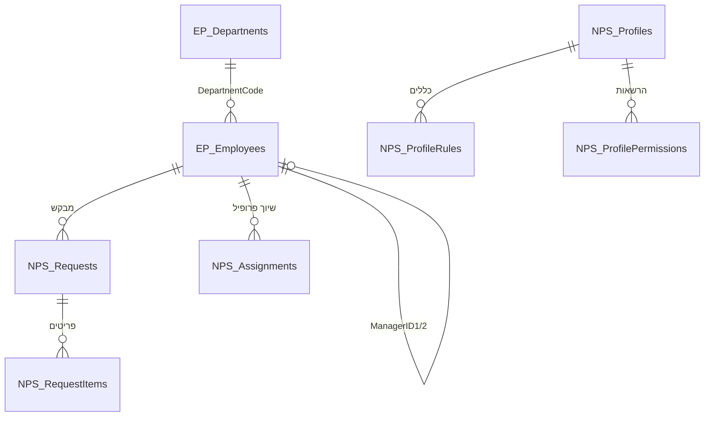

# מסד נתונים

## הערה חשובה

**אין קבצי SQL, migrations או DDL ב-repository זה.** המסד נמצא ב-SQL Server על שרתי ה-RFC. המידע להלן מבוסס על:

- `NPS-README.md`
- מודלים ב-`src/app/nps-permissions/models/nps.models.ts`
- קבצי `BACKEND_PROMPT.md` בתיקיות feature
- שמות טבלאות שמוזכרים בקוד Angular

---

## חיבור

| פרמטר | ערך |
|--------|-----|
| Connection string | `NpsConnection` ב-`Web.config` של שרת RFC |
| סכימה NPS | `NPS` |
| סכימה כללית | `dbo` (טבלאות `EP_*`) |
| קוד Backend | `RFC/App_Code/Nurses/NursesPermissions.cs` |

---

## סכימת NPS (Nurses Permissions System)

### טבלאות עיקריות (מוזכרות במודלים ובתיעוד)

| טבלה | תיאור |
|------|--------|
| `EP_Employees` | עובדים — `EmployeeID`, `ADUserName`, `DepartnentCode`, `ManagerID1`, `ManagerID2` |
| `EP_Departnents` | מחלקות |
| `EP_NursePermissionActions` | פעולות הרשאה |
| `EP_NursePermissionPermissions` | הרשאות |
| `EP_NursePermissionNurses` | אחיות במערכת |
| `NPS.DepartmentChangeQueue` | תור שינויי מחלקה — מעבד לבקשות אישור |

### ישויות עסקיות NPS

- **Profiles** — פרופילי הרשאה עם Priority
- **Profile Rules** — כללי התאמה לפי מחלקה + השכלה + התמחות
- **Permissions** — הרשאות בודדות
- **Actions** — פעולות לפי מחלקה
- **Requests** — בקשות אישור (Manager1 → Manager2 → Employee)
- **Assignments** — שיוך פרופיל לעובד
- **Audit** — לוג שינויים

### Views ו-Stored Procedures

- **לא מתועדים** בקוד Angular.
- ה-Backend משתמש ב-SQL מוטמע (embedded SQL) ב-`NursesPermissions.cs`, לא ב-SP ייעודיים שמוזכרים ב-Frontend.

---

## טבלאות נוספות (מוזכרות ב-WebMethods)

רוב ה-feature modules קוראים ל-WebMethods ללא חשיפת שמות טבלאות. דוגמאות לדומיינים:

| דומיין | WebMethods רלוונטיים | הערות |
|--------|---------------------|--------|
| בית-חולים BI | `GetTableViewForHospitalDashboard`, `GetStatsValues` | נתוני KPI |
| הכנסות | `GetChargingIncome`, `GetChargingChartData` | גבייה והכנסות |
| קטטריזציה | `GetCathCombined`, `GetIncomeDataCombined` | מעבדת צנתור |
| תורים | `GetAppointments`, `GetAppointmentscl` | זמני המתנה |
| חדרי ניתוח | `GetRoomAggregateDaysD`, `GetSurgeryRooms` | ניצול חדרים |
| ניתוחים | `GetRevenueByProcedureFiveYears_*` | הכנסות ניתוחים |
| COVID | `GetAllSarscov2`, `SubmitCovid19Report` | מעקב קורונה |
| מחקרים | `GetResearchesTable`, `InsertOrUpdateResearches` | רישום מחקרים |
| אחיות | מערכות nurses-dashboard, nurses-manage | דוחות ותפוסה |

---

## מפתחות ראשיים וזרים (NPS)

> שמות הטבלאות `NPS_*` הם לוגיים — השמות הפיזיים ב-SQL עשויים להיות `EP_NursePermission*` או `NPS.*`.

---

## שאילתות נפוצות (בצד Backend)

Angular לא מריץ SQL ישירות. דפוסי גישה נפוצים ב-Backend:

1. **SELECT לפי EmployeeID** — `GetUserFullNameByUserID`, `NpsGetEmployee`
2. **SELECT עם פילטר מחלקה/תאריך** — דשבורדים (`GetAppointments`, `GetChargingIncome`)
3. **INSERT/UPDATE דרך WebMethods** — `InsertOrUpdateResearches`, `SaveReHospNote`
4. **Queue processing** — `NpsProcessQueue` מעבד `DepartmentChangeQueue` (Pending)

---

## ביצועים

### המלצות כלליות

- הימנע מ-`SELECT *` ב-Backend (הנחיה לפיתוח SQL).
- דשבורדים מבצעים קריאות HTTP נפרדות לכל chart — שקול איחוד ב-Backend (`GetCathCombined` כבר מאחד).
- `NpsBaseApiService.getAccessContext()` משתמש ב-`shareReplay(1)` ל-cache בצד Client.
- `department-income-local-cache.service.ts` — cache ב-localStorage (ללא HTTP).

### אינדקסים

לא מתועדים ב-repository. יש לבדוק ב-SQL Server על שרת ה-RFC לפי execution plans.

---

## קונבנציות שמות

| סוג | דפוס | דוגמה |
|-----|------|--------|
| טבלאות EP | `EP_<Entity>` | `EP_Employees` |
| סכימת NPS | `NPS.<Table>` | `NPS.DepartmentChangeQueue` |
| עמודות | PascalCase | `EmployeeID`, `DepartnentCode` |
| שדה מחלקה | `DepartnentCode` (כתיב עם typo היסטורי) | — |

---

## עדכון אחרון

נוצר: 2026-07-05. יש לעדכן כשמתווספים WebMethods חדשים או כשמתקבלת גישה לסכימת SQL מלאה.
